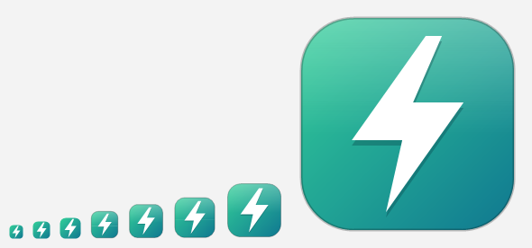

# UPS Tools



A small Windows tray app that watches one or more UPSes / portable power stations and runs your scripts when their
state changes, e.g. pause games and put the NAS to sleep when the grid goes down, hibernate the PC when the battery runs
low, and wake the NAS when the grid comes back.

- **Several UPSes**: pair as many as you like; they are monitored at the same time, each with its own scripts, event
  limits and notifications, and optionally a name of its own (e.g. *Desk*, *Server rack*) that notifications, the tray
  and the log use. With more than one, a picker next to the tabs chooses the UPS the window shows, and the dashboard
  has a tile for each.
- **Network sharing**: several PCs can watch the same UPS. With *Share with other PCs* on and the same sharing code,
  the PCs on your network find each other, only one of them connects to each UPS over Bluetooth, and the others read
  it through that one, each with its own scripts and notifications; another PC takes over if that one goes away. UPSes
  another PC is connected to show up in **Add UPS…** (see [Network sharing](#network-sharing)).
- **Dashboard**: grid status, battery level, charge/discharge rate, estimated time on battery, input and output power, recent activity.
- **Scripts**: attach any number of scripts to each event of each UPS. `.ahk`, `.bat`, `.cmd` and `.exe` files open with their Windows
  file association; `.ps1` files run hidden through PowerShell. Arguments are optional.
  - They start in the listed order; drag a script by its handle (or Alt+Up / Alt+Down) to reorder.
  - **Wait until it finishes**: the next script starts only after this one exits with code 0. If it fails (another exit
    code, or it can't be started), the scripts after it are skipped, and a notification says so.
    - **at most … min**: if it is still running after that long, the next script starts anyway and a notification says
      so; the script itself keeps running. 0 (the default) waits as long as it takes. Use it for a script that could
      hang before a *Hibernate*, e.g. one that shuts down VMs.
  - **Run as administrator**: the script runs elevated without a UAC prompt when the event fires, so it works with
    nobody at the PC (see [Scripts that run as administrator](#scripts-that-run-as-administrator)).
  - **Add action** → *Sleep*, *Hibernate* or *Shut down*: no script needed. A window on top of everything counts down
    first (60 s by default, 0–600), with *Cancel* and *… now*; with nobody at the PC, it runs out and the action goes
    ahead. Cancelling skips the scripts after it. The scripts after *Sleep* or *Hibernate* run once the PC is back on.
    *Shut down* closes apps even if they have unsaved work, which the empty battery would lose anyway.
  - When the grid comes back, the *Grid lost* and *Battery low* scripts that haven't started yet are skipped, e.g.
    *Grid lost* → `wait 5 minutes` (waited for) → `hibernate` doesn't hibernate the PC after a 2-minute outage, and a
    countdown still running closes. When the UPS answers again, the same goes for the *UPS unreachable* scripts.
- **Script variables**: scripts get the event and the UPS's state in environment variables (see
  [Environment variables](#environment-variables)), so one script can serve several events or pass the state on.
- **Notifications**: a Windows notification for each event, e.g. *Grid lost — running on battery: Battery 87 % ·
  about 6 h 10 m left at 120 W*, naming the scripts it started and the UPS. *Grid restored* says how long the outage
  lasted and replaces the same UPS's *Grid lost* or *Battery low* notification; *UPS reachable again* replaces
  *UPS unreachable*. Clicking one opens the app.
- **Tray icon**: coloured by the UPS that needs attention most (red: unreachable, yellow: on battery, green: all on
  the grid); its tooltip has a line for each UPS.
- **Configuration**: add and forget UPSes, close to tray, start with Windows, the update period; for each UPS, its
  name, how long the grid must be gone before *Grid lost*, the *Battery low* limits, which events notify.
- **Updates**: Configuration → About → **Check for updates** looks for a newer release here; **Update to X.Y.Z** downloads
  its setup, checks it against the SHA-256 GitHub lists for it and runs it, which updates the app and opens it again.

| Event | Fires when |
|---|---|
| Grid lost | Mains voltage at the UPS input disappears (UPS switches to battery), and stays gone for the *Grid lost grace period* set in Configuration (none by default) |
| Battery low | On battery, the charge falls to 20 % or the time left to 10 minutes (both can be changed or turned off), or, if set, the UPS has been unreachable on battery for a while; once per outage |
| Grid restored | Mains voltage comes back |
| UPS unreachable | 3 polls in a row fail |
| UPS reachable again | The UPS answers again after being unreachable |

Events fire on transitions only. The first reading after start-up is a baseline, so starting the app during an outage
does not fire "Grid lost". *Battery low* is the exception: started on battery with the battery already low, it fires on
the first reading. The time left is the stored energy divided by the average load of the last 5 minutes (the UPS's own
estimate isn't used: it runs far longer than the battery can last), and it has to be at or below the limit in two
readings in a row.

With a *Grid lost grace period* (Configuration → Events), a blip shorter than it fires nothing: no scripts, no
notification, only a line in the log. Once the grace period is over, *Grid lost* fires, and the outage (in *Grid
restored* and `UPS_OUTAGE_SECONDS`) counts from the first reading without the grid. *Battery low* waits for *Grid lost*.

If the UPS stops answering while on battery (e.g. its Bluetooth link drops), nothing tells how much charge is left.
With a *UPS unreachable on battery grace period* set (Configuration → Events, off by default), *Battery low* fires
once it has been unreachable that many minutes; its notification says so and shows the last reading, and its scripts get
`UPS_REACHABLE=0`. If the UPS answers again first, nothing fires; if it answers with the grid back, *Grid restored*
stops the *Battery low* scripts as usual.

## Supported devices

| Device | Transport | Status |
|---|---|---|
| Bluetti Elite 100 V2 (EL100V2) | Bluetooth LE (encrypted) | Tested |
| Bluetti AC60/AC60P, AC70/AC70P, AC180/AC180P/AC180T, AC2A/AC2P, AP300, EL10, EL30V2, PR30V2, PR100V2, Handsfree 1/2 | Bluetooth LE | Same register layout, untested |
| EcoFlow River 3 Plus, with or without its Smart Extra Battery | Bluetooth LE (encrypted, EcoFlow account) | Tested |
| EcoFlow River 3, River 3 UPS, River 3 Plus (270), River 3 Plus Wireless | Bluetooth LE (encrypted, EcoFlow account) | Same messages, untested |

Bluetti doesn't publish its protocol. The Bluetooth protocol and the "V2" channel encryption are ported from the community
reverse-engineering in [bluetti-bt-lib](https://github.com/Patrick762/bluetti-bt-lib) (MIT). Bluetti's official license
file is not needed.

Neither does EcoFlow. Its Bluetooth protocol (the secp160r1 key exchange, the session key table, the packet format and the
River 3 messages) is ported from [ha-ef-ble](https://github.com/rabits/ha-ef-ble) (Apache License 2.0). An EcoFlow device
only talks to the EcoFlow account it was added to in the EcoFlow app, so pairing one asks for that account's user ID: enter
it, or let Find UPS look it up by signing in to EcoFlow with the account's email and password. Only the user ID is saved
(in `settings.json`); the password is sent to EcoFlow (`api.ecoflow.com`) and nowhere else. The River 3 Plus doesn't
report how much energy it holds, so the time left is worked out from its model's capacity (286 Wh), plus 286 Wh for a
Smart Extra Battery when one is plugged in; it doesn't report its input voltage either, so the grid counts as present
while its AC input is plugged in.

A UPS accepts a single Bluetooth connection: while UPS Tools is connected to it, its phone app can only reach it over
Wi-Fi, and another PC can only reach it through this one ([Network sharing](#network-sharing)).

## Network sharing

Turn on Configuration → Network sharing → **Share with other PCs** on each PC that watches a UPS, and give them all
the same **sharing code** (the first PC makes one up: copy it, and paste it on the others). Then:

- The PCs find each other on the local network on their own: each announces itself every 5 s over UDP multicast
  (239.255.47.70, port 47870). The card lists the PCs found and the UPSes they are connected to, and a PC that has
  another code.
- For each UPS, only one PC connects over Bluetooth. The others read it through that PC over TCP (port 47870, or
  another free one), getting each reading as soon as that PC has it, and each runs its own scripts and notifications
  with its own event limits. The dashboard and the list of UPSes say which PC a UPS is read through.
- When the PCs start together, the one that connects is chosen by a fixed order. If it exits, sleeps, shuts down or
  turns sharing off, it tells the others, and one of them connects at once; if it disappears without a word (e.g. it
  lost its network), the others take over after about 17 s. A PC that is connected but has had the UPS unreachable for
  2 minutes (e.g. out of Bluetooth range) lets another one try.
- **Add UPS…** lists the UPSes the other PCs are connected to: pairing one takes its name from that PC and doesn't
  connect to it.

Only PCs with the same code can take part: the announcements are encrypted and authenticated (AES-GCM) with a key
derived from the code, and so are the links that carry the readings, so nobody else on the network can read the UPS or
pass off a reading as its own (e.g. a fake *Grid lost* that runs your shutdown scripts). The code itself never goes over
the network. Windows may ask once whether UPS Tools may use the network: allow it on private networks. A PC with
sharing off connects over Bluetooth regardless, so turn it on on every PC that has the same UPS paired.

## Requirements

- Windows 10 2004 or later (Windows 11 recommended), Bluetooth LE adapter
- [.NET 10 Desktop Runtime](https://dotnet.microsoft.com/download/dotnet/10.0) (x64)

## Install

Download `UpsTools-X.Y.Z-setup.exe` from [Releases](https://github.com/dkozlov-ua/ups-tools/releases) and run it. It
installs into `%LOCALAPPDATA%\Programs\UpsTools` without administrator rights, with a *UPS Tools* Start menu shortcut.
Running a newer setup, or **Update** in the app, updates that folder in place; uninstall it from Settings → Apps → *Installed apps*. The setup isn't
signed, so SmartScreen may ask you to confirm (*More info* → *Run anyway*). See [RELEASE.md](RELEASE.md).

## Usage

- Configuration → **Add UPS…** → select your UPS → **Pair**. For an EcoFlow UPS, enter the user ID of its EcoFlow
  account first, or the account's email and password and **Look up user ID**. Do the same for each UPS; pairing one
  that is already in the list again updates it (e.g. its user ID) and keeps its scripts. **Forget** removes a UPS with
  its scripts.
- Settings and the log are in `%APPDATA%\UpsTools` (`settings.json`, `ups-tools.log`). Settings of 0.6.0 and earlier
  (one UPS) are moved into the list of UPSes when the app starts; the old file stays as `settings.json.before-0.7.0`.
- Notifications are registered as *UPS Tools* (`HKCU\Software\Classes\AppUserModelId\DKozlov.UpsTools`); their images
  are in `%LOCALAPPDATA%\UpsTools`. Windows' own settings (Do not disturb, the per-app switch) decide whether they pop up.
- `UpsTools.exe --background` starts hidden in the tray (used by "Start with Windows").
- `UpsTools.exe --run-script "<path>" [arguments]` runs a script and exits with its exit code (used by the administrator
  tasks).
- `UpsTools.exe --exit` makes a running copy exit cleanly and waits for it (up to 30 s; exit code 1 if it is still
  running), e.g. before replacing the exe.
- `UpsTools.exe --uninstall` exits a running copy and removes what the app created outside its folder (used by the
  uninstaller; see [RELEASE.md](RELEASE.md#what-the-setup-does)).
- Set the environment variable `UPSTOOLS_TRACE=1` to log the Bluetooth protocol exchange for troubleshooting.

### Environment variables

Every script gets these, with the UPS's state when the event fired (for *Run now*, its latest reading). One the UPS
doesn't report, or that doesn't apply, isn't set.

| Variable | Value |
|---|---|
| `UPS_EVENT` | `GridLost`, `BatteryLow`, `GridRestored`, `UpsUnreachable` or `UpsReachable` |
| `UPS_MANUAL` | `1` when started by *Run now* |
| `UPS_GRID` | `1` with mains power at the UPS input, `0` on battery |
| `UPS_REACHABLE` | `1` while the UPS answers, `0` when it is unreachable (the readings are then its last ones) |
| `UPS_BATTERY_PERCENT` | Charge, e.g. `87` |
| `UPS_RUNTIME_MINUTES` | Estimated minutes left on battery at the average load of the last 5 minutes |
| `UPS_LOAD_W` | Output power in watts |
| `UPS_OUTAGE_SECONDS` | For *Grid restored*, how long the outage lasted; on battery, how long it has lasted so far |
| `UPS_NAME` | The UPS's name in UPS Tools: the one you gave it, or its brand and model, e.g. `Bluetti EL100V2` |
| `UPS_MODEL`, `UPS_SERIAL` | The UPS |
| `UPS_READING_TIME` | When the readings were taken, e.g. `2026-11-05T21:30:05+02:00` |

E.g. in a `.ps1`: `if ([int]$env:UPS_BATTERY_PERCENT -lt 30) { ... }`; in a `.bat`: `echo %UPS_EVENT% >> ups.log`.

Scripts that run as administrator get them too: just before starting the task, UPS Tools writes them to
`%LOCALAPPDATA%\UpsTools\script-env`, where the task picks them up (a file older than 2 minutes is ignored).

### Scripts that run as administrator

Ticking *Run as administrator* creates a scheduled task, `\UpsTools\script-<id>` in Task Scheduler, that runs
`UpsTools.exe --run-script "<script>" <arguments>` with the highest privileges. Creating it asks for administrator rights
once. When the event fires, UPS Tools starts the task, which needs no prompt, and reads the script's exit code from it.
The task runs on battery power too.

- Changing the arguments updates the task, which asks for administrator rights again. Unticking the box or removing the
  script deletes the task. If the task is missing or out of date (e.g. after restoring `settings.json` on another PC),
  the script shows **Repair**.
- Your Windows account must be an administrator. With a standard account, the task runs without elevation.
- Anything running under your account can edit a script set to run as administrator, or UPS Tools itself, and have
  it run elevated without a prompt. Keep those scripts in a folder only administrators can write to,
  e.g. under `C:\Program Files`, if that matters to you.
- Uninstalling UPS Tools deletes the tasks; that asks for administrator rights once.

## Development

```
dotnet build
dotnet test tests/UpsTools.Tests        # protocol, monitor, events
dotnet test tests/UpsTools.App.Tests    # services, view models, the app's controller
dotnet test tests/UpsTools.UiTests      # end to end: drives the app's windows
dotnet run --project src/UpsTools
```

| Path | Contents |
|---|---|
| `src/UpsTools.Core` | Device-independent model (`UpsStatus`, `UpsMonitor`, `UpsStateTracker`, `IUpsDriver`), the shared Bluetooth LE link (`Ble`), the Bluetti and EcoFlow BLE drivers and the simulated UPS |
| `src/UpsTools` | WPF app (Fluent theme, tray icon, settings, script runner) |
| `tests/UpsTools.Tests` | Core: the Bluetti protocol against reference vectors, a real Elite 100 V2 register dump and a simulated device (handshake, fragmented notifications, dropped links, stalls); the EcoFlow protocol against ha-ef-ble's algorithms, real River 3 packets and a simulated device (key exchange, authentication, uploads in parts, silence, reconnects); the monitor, events, script chains, notification texts |
| `tests/UpsTools.App.Tests` | App: settings, log, Start with Windows, notifications, scripts (real processes), administrator tasks (real Task Scheduler), the uninstaller, tray art, view models, and the controller with a scripted UPS |
| `tests/UpsTools.UiTests` | End to end: starts `UpsTools.exe` with a simulated UPS and uses it through UI Automation and real mouse and keyboard input |
| `tools/make-icon.cs` | Regenerates `app.ico`: `dotnet run tools/make-icon.cs` |
| `VERSION` | The only version, `X.Y.Z` |
| `installer/UpsTools.iss` | The Inno Setup script for the setup |
| `package.ps1`, `publish.ps1` | Build the setup, publish a GitHub release: see [RELEASE.md](RELEASE.md) |

To support another manufacturer, implement `IUpsDriver` / `IUpsConnection` and register it in `UpsDrivers`.

### Testing

- **Profiles.** `UpsTools.exe --profile name` (or `UPSTOOLS_PROFILE=name`) runs a separate copy: its own
  settings and log (`%APPDATA%\UpsTools-name`), single-instance signals, Start with Windows entry, notification
  registration and administrator tasks (`\UpsTools-name`). It neither touches nor talks to the installed copy, which
  can keep running. The test suites run as such profiles and remove what they create.
- **Simulated UPS.** With `UPSTOOLS_SIMULATOR` set to a JSON file, the simulator is the only UPS driver. Every poll
  reads the file, e.g. `{"GridPresent": false, "BatteryPercent": 80, "AcOutputW": 120}`; `{"Fail": "message"}` makes
  polls fail (see `SimulatedUpsDriver`). Find UPS finds it while the file exists. Several files separated by `;` are
  several UPSes (`00:00:00:00:00:01`, `…:02`, …). With the simulator, *Sleep*,
  *Hibernate* and *Shut down* only write to the log.
- **Administrator tasks.** The tests that register real scheduled tasks run only in an elevated shell; otherwise
  they are skipped.
- **UI tests** start the app, click, type and drag, so they need the desktop to themselves while they run (about
  a minute): don't use the mouse or keyboard meanwhile. `package.ps1` doesn't run them.
